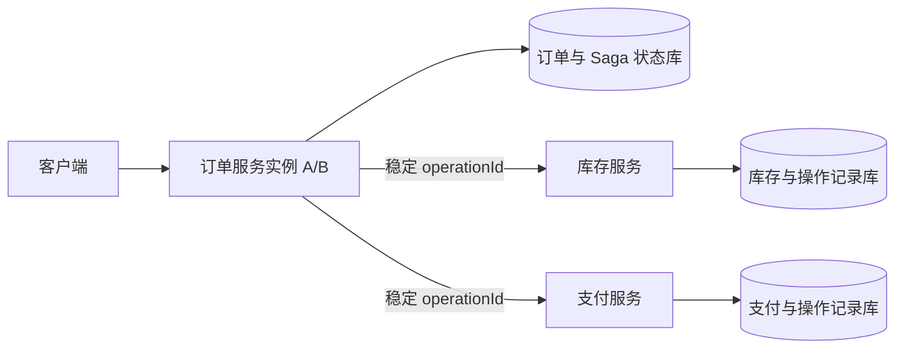

# Spring 集群事务组件设计（v0.1）

## 1. 定位与保证

组件以 Spring Boot Starter 的形式接入应用，第一版只支持跨服务、顺序执行的 Saga。业务服务各自提交本地事务；协调器持久化执行进度，在故障后重试、查询结果或补偿。

组件提供的是**可恢复的最终一致性**，不承诺跨 HTTP 服务的原子提交，也不把普通 `@Transactional` 包装成分布式事务。对外暴露 `RUNNING`、`SUCCEEDED`、`COMPENSATING`、`COMPENSATED`、`NEEDS_ATTENTION` 等明确状态。

适用前提：

- 每个参与操作有稳定的业务幂等键，并能查询此前操作的结果。
- 对已提交的步骤，业务提供幂等的补偿操作；不可补偿的动作必须安排在业务允许的位置，或改用其他模式。
- 协调器与参与方的状态存储可靠，数据库提交后可恢复。

如果所有资源都支持 XA，且业务要求同步原子提交，应直接评估 JTA/XA，而非使用本 Saga 组件。

## 2. 模块

| 模块 | 职责 |
| --- | --- |
| `cluster-tx-core` | 流程定义、状态机、步骤接口、错误分类、重试策略 |
| `cluster-tx-jdbc` | 协调器和参与方状态表、条件更新、租约、恢复扫描 |
| `cluster-tx-spring-boot-autoconfigure` | 条件装配、配置属性、健康指标、扩展点 |
| `cluster-tx-spring-boot-starter` | 汇集常用依赖 |
| `cluster-tx-sample` | 订单、库存、支付的端到端示例与故障测试 |

第一版使用数据库作为持久化任务队列。需要可靠发布领域事件时，再增加独立的 Outbox 适配模块；不把 Kafka 作为组件运行的前提。

Spring Boot 接入使用 `@AutoConfiguration`，并在 `META-INF/spring/org.springframework.boot.autoconfigure.AutoConfiguration.imports` 登记配置类。通过 `@ConfigurationProperties(prefix = "cluster.tx")` 提供启停、扫描间隔、租约时长和重试上限等配置；用条件装配注册默认仓储、调度器与客户端，允许应用替换实现。组件不覆盖应用已有的 `PlatformTransactionManager`；参与方本地操作使用应用明确指定的事务管理器。`starter` 只汇集依赖，自动配置和核心逻辑分别放在前两个模块中。

## 3. 面向业务的 API

推荐显式定义流程，不以 AOP 拦截任意 `@Transactional` 方法来推断远程副作用。下列代码表示 API 形状，具体类型可在实现阶段确定：

```java
SagaDefinition<OrderCommand> placeOrder = SagaDefinition.<OrderCommand>builder("place-order", 1)
    .step("reserve-inventory", inventoryAction)
    .step("charge-payment", paymentAction)
    .step("confirm-order", orderAction)
    .build();

SagaHandle handle = sagaClient.start("place-order", orderId, command);
SagaStatus status = sagaClient.status(handle.id());
```

`start` 用 `workflowName + businessKey` 去重，并返回流程 ID；它不承诺所有远程步骤已同步完成。每个 `Action` 提供 `execute`、`query`、`compensate`，调用时携带 `transactionId`、`stepId`、`phase` 和稳定的 `operationId`。定义版本与请求数据必须持久化，以便升级后恢复旧流程。

参与方本地处理应在**同一个本地事务**中写入业务变更和执行结果，并对 `operationId` 建唯一约束。重复请求直接返回已保存的结果；补偿同样要幂等。即使补偿先于迟到的执行请求到达，也要记录取消栅栏，使后续执行被拒绝。对于外部支付等资源，必须使用对方提供的幂等键和结果查询能力；否则组件无法安全判断超时后的结果。

## 4. 持久化与状态机

- `saga_instance`：`id`、`workflow_name`、`workflow_version`、`business_key`、`payload`、`state`、`current_step`、`version`、`lease_owner`、`lease_until`、`next_run_at`、`created_at`、`updated_at`。唯一键 `(workflow_name, business_key)`。
- `saga_step`：`instance_id`、`step_name`、`phase`、`state`、`operation_id`、`attempts`、`result`、`last_error`、`updated_at`。唯一键 `(instance_id, step_name, phase)`。
- `participant_operation`：`operation_id`、`state`、`execute_result`、`compensate_result`、`updated_at`。`operation_id` 为唯一键；状态至少区分 `EXECUTED`、`COMPENSATED`、`CANCELLED`。执行和补偿对同一行加锁或条件更新，并与对应业务变更在同一个数据库事务内提交。补偿先到时写入 `CANCELLED`，迟到的执行请求不得再产生副作用。

正常路径：`RUNNING → SUCCEEDED`。确认失败后：`RUNNING → COMPENSATING → COMPENSATED`。达到重试上限或无法确定是否可补偿时进入 `NEEDS_ATTENTION`，保留全部上下文供人工处理，不伪装为成功或已回滚。

## 5. 集群执行与故障规则

1. 工作节点通过条件更新取得到期实例的租约。每次状态推进都校验 `version` 和租约代数，防止旧节点覆盖新节点结果。租约不能阻止旧节点已经发出的远程请求，因此参与方幂等仍是必需条件。
2. 发送步骤请求前先持久化步骤意图；请求成功后持久化结果并推进下一步。进程在这两个提交点之间崩溃时，由恢复任务查询参与方结果。
3. 超时、连接断开、进程退出属于**结果未知**，先执行 `query(operationId)`；不能仅凭超时发起补偿。明确的可重试错误按指数退避重试；明确的业务拒绝进入补偿。
4. 补偿按已成功步骤的逆序执行。补偿失败按策略重试并告警；超出自动恢复预算后暂停在 `NEEDS_ATTENTION`，由人工决定继续重试或采取业务处理，并记录操作者、原因与结果。
5. 每次调用传播事务 ID、步骤 ID 和链路追踪信息；指标至少包括未完成数量、最老未完成时长、重试次数和待人工处理数量。

## 6. 第一版验收

用订单 → 库存 → 支付流程证明以下性质：

- 相同业务键重复启动，只产生一个流程实例。
- 远程步骤已经提交但响应丢失，恢复后不会重复扣款或扣库存。
- 任意一步明确失败，已完成步骤按逆序补偿；补偿重复执行没有额外副作用。
- 两个协调器实例竞争同一任务，不会产生不可恢复的重复业务效果。
- 分别在步骤提交前后、收到响应前后、补偿期间杀死进程，重启后最终进入明确终态或 `NEEDS_ATTENTION`。

第二阶段再评估并行步骤、TCC 资源适配、消息 Outbox、管理界面与多数据库方言。

## 7. 部署边界与调用路径

第一版采用**嵌入式协调器**：发起业务的服务引入 Starter，其多个实例共享同一协调器数据库；参与服务各自引入参与方模块，并在自己的数据库中保存 `participant_operation`。协调器与参与方不共享业务数据库，不要求独立部署事务服务器。跨服务传输由 `SagaTransport` 接口隔离，示例实现可使用 HTTP；核心模块不依赖特定 RPC 或消息中间件。



协调器数据库至少与发起服务的 `PENDING` 业务记录位于同一事务资源中。创建业务记录和 `saga_instance` 必须原子提交；若两者在不同数据库，发起方必须使用 Outbox 桥接，否则可能出现“业务记录已创建但流程未启动”。远程调用始终发生在本地事务之外，避免持有数据库锁等待网络。

## 8. 对外契约与扩展接口

```java
interface SagaClient {
    SagaHandle start(String workflowName, String businessKey, Object input);
    SagaSnapshot get(String sagaId);
}

interface SagaAction<C> {
    OperationState execute(SagaContext<C> context);
    OperationState query(SagaContext<C> context);
    OperationState compensate(SagaContext<C> context);
}

interface ParticipantHandler<C> {
    OperationState apply(C command);
    void compensate(C command);
}

enum OperationState {
    NOT_FOUND, EXECUTED, REJECTED, CANCELLED, COMPENSATED, UNKNOWN
}
```

`SagaAction` 在协调器一侧实现，负责通过 `SagaTransport` 调用参与服务；`ParticipantHandler` 在参与服务实现实际业务变更，由参与方执行器负责幂等记录和状态查询。Starter 不默认开放 HTTP 端点；传输适配器必须显式配置路由与身份验证。这些签名用于固定语义，实际实现时可细化为不同的执行结果和查询结果类型，避免业务返回非法状态。`SagaContext` 包含 `sagaId`、`operationId`、步骤名、流程版本、业务键、负载和截止时间，不包含当前工作节点 ID。`operationId` 对同一步的所有重试保持不变，执行和补偿使用同一个 ID。

`start` 的幂等键是 `(workflowName, businessKey)`。相同键、相同请求摘要返回原流程；相同键但不同请求摘要返回冲突，不允许悄悄复用。`SagaSnapshot` 提供已完成步骤、当前状态、错误原因和最近更新时间。业务接口默认返回流程 ID 与 `RUNNING`，调用方通过查询接口获取终态；同步等待只能作为有明确超时时间的可选能力。

流程定义按 `(workflowName, workflowVersion)` 注册且不可变。实例保存定义版本和可重放的输入；部署新版本时，在旧实例结束前保留旧版处理器。业务负载应设置大小上限，避免写入密码或支付凭证。

## 9. 状态转换与结果判定

协调器只允许以下关键转换，所有转换在数据库事务中通过版本条件更新完成：

| 当前状态 | 条件 | 下一状态 |
| --- | --- | --- |
| `RUNNING` | 下一步明确成功 | `RUNNING`，推进步骤；最后一步则为 `SUCCEEDED` |
| `RUNNING` | 步骤明确业务拒绝 | `COMPENSATING` |
| `RUNNING` | 超时、断连或进程退出 | 保持 `RUNNING`，步骤标记 `UNKNOWN`，安排查询 |
| `COMPENSATING` | 一个补偿完成 | 继续逆序补偿；全部完成则为 `COMPENSATED` |
| 任一非终态 | 无法判断结果或自动恢复次数耗尽 | `NEEDS_ATTENTION` |

`UNKNOWN` 不能被当作失败。例如支付请求已在支付服务提交，但响应在网络中丢失；协调器先用原 `operationId` 查询。查询确认 `EXECUTED` 才推进；确认 `REJECTED` 才补偿；查询仍不确定则退避重试并告警。查询得到 `NOT_FOUND` 也不能直接认定原请求不会迟到：若决定放弃该步骤，先向参与方发送补偿请求，等待它持久化 `CANCELLED` 栅栏，再补偿此前已完成的步骤。若决定继续执行，则使用原 `operationId` 重试。

参与方状态转换：`NOT_FOUND → EXECUTED/REJECTED`；`EXECUTED → COMPENSATED`；`NOT_FOUND → CANCELLED`。`CANCELLED` 是补偿先到时留下的栅栏，禁止迟到的执行请求产生副作用。状态变更与对应业务数据更新必须共用同一个数据库事务和同一个 `DataSource`。若参与方调用了无法纳入本地事务的外部系统，它还必须依赖该系统的幂等与查询协议，不能只靠本表提供保证。

## 10. 持久化约束

第一版使用 JDBC，实际 SQL 由目标数据库方言提供。生产环境使用版本化迁移脚本建表；Starter 启动时检查表结构版本，不自动修改业务数据库。

| 表 | 必要约束与索引 |
| --- | --- |
| `saga_instance` | 主键 `id`；唯一 `(workflow_name, business_key)`；索引 `(state, next_run_at, lease_until)`；保存单调递增的 `version` 和 `lease_epoch` |
| `saga_step` | 唯一 `(instance_id, step_name)`；保存稳定 `operation_id`、执行与补偿状态、两类重试次数、最近错误 |
| `participant_operation` | 主键 `operation_id`；状态与执行、补偿结果；与业务表处于同一事务资源 |
| `saga_audit` | 追加写入状态转换、人工处理动作和原因；用 `saga_id` 与时间建立索引 |

实例与步骤的状态推进必须一起提交。参与方执行时先尝试写入操作记录并在同一事务内完成业务更新；并发的执行或补偿请求争用相同 `operation_id`，利用唯一约束与行锁串行化。补偿先到则写入 `CANCELLED`；执行先提交则补偿读取 `EXECUTED` 并撤销相应业务效果。`REJECTED` 表示业务规则拒绝且没有产生需要补偿的效果。

## 11. 集群调度和恢复

工作节点扫描 `next_run_at` 到期的实例，通过数据库条件更新抢占租约，增加 `lease_epoch`。执行网络请求前先提交步骤意图；网络请求期间不持有协调器数据库事务。写回结果时校验 `version` 和 `lease_epoch`；失去租约的旧节点不得覆盖新节点的状态。租约使用数据库时间判断到期，减少节点时钟偏差的影响。

租约只能限制协调器写入，不能撤回已经发出的远程请求。因此即使发生租约过期、重复派发或旧节点迟到，安全性仍依赖参与方的幂等与取消栅栏。扫描器重启后从数据库恢复，不依赖内存队列。所有后台线程必须可优雅停机；停机期间到期任务由其他实例接管。

重试策略按异常分类：业务拒绝进入补偿；网络错误进入结果查询；参与方明确表示临时不可用才重试执行；流程定义缺失、输入无法反序列化或违反业务前提进入 `NEEDS_ATTENTION`。重试使用退避与抖动，并设单实例上限，避免故障时所有节点同时压垮参与服务。补偿失败在自动恢复预算内继续重试；耗尽预算后暂停、告警并等待人工接管。

## 12. 业务约束与验收标准

插件只能管理调用与恢复，不能自动证明业务补偿正确。每个步骤上线前需写明：业务不变量、执行后的可见状态、补偿动作、是否有不可逆副作用、最大处理中时长。例如库存扣减使用数据库条件更新防止超卖；退款是新的资金操作，不等于删除原扣款记录。

第一版验收除第 6 节的故障注入外，还需覆盖：

1. 在创建 `PENDING` 订单与启动 Saga 之间注入异常，验证两者同时提交或同时回滚。
2. 补偿先于迟到的执行到达，验证执行被栅栏拒绝。
3. 同一业务键用不同负载启动，验证返回冲突。
4. 旧工作节点租约失效后返回成功，验证不能覆盖新节点状态。
5. 流程升级期间保留旧定义，验证旧实例仍可恢复。
6. 支付查询持续未知、补偿持续失败时，验证流程保持可查询并触发告警，不被标记为成功。

## 13. 实施顺序与待确认项

实施顺序：先完成状态机与 JDBC 仓储；再做参与方幂等和取消栅栏；然后做调度、租约与恢复；最后封装自动配置、示例和故障测试。核心逻辑先以显式 API 接入；注解可以在后续版本作为薄封装，不能改变事务保证。

开始编码前需要确定目标 Spring Boot 主版本、Java 版本、首个数据库方言、服务间通信方式，以及第一条样板业务是否存在无法补偿的外部操作。这些选择影响依赖和适配器实现，但不改变上述状态与故障语义。

设计参考：[Spring Boot 自动配置](https://docs.spring.io/spring-boot/reference/features/developing-auto-configuration.html)、[Spring 程序化事务](https://docs.spring.io/spring-framework/reference/data-access/transaction/programmatic.html)、[Seata Saga 机制与限制](https://seata.apache.org/docs/user/mode/saga/)、[Debezium Outbox](https://debezium.io/documentation/reference/stable/transformations/outbox-event-router.html)。
